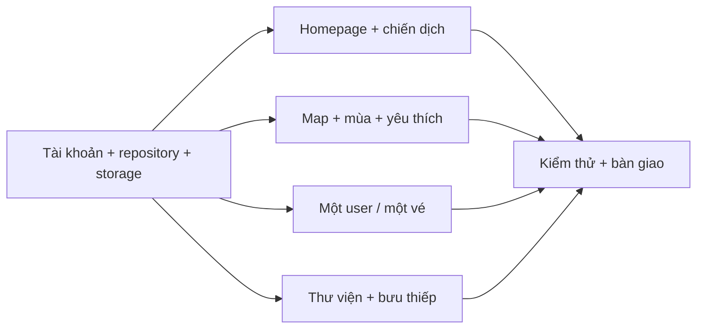

# Kế hoạch triển khai chức năng phía user

Phạm vi: chức năng 1–18 trong danh sách yêu cầu. Chức năng quản trị 19–27 chưa triển khai trong kế hoạch này; chỉ dùng các bảng dữ liệu đã chuẩn bị sẵn khi cần.

## Quy tắc đã chốt

- Mỗi user có tối đa **một vé** trên toàn hệ thống, không phải một vé cho mỗi chiến dịch. Chỉnh sửa cập nhật trực tiếp vé hiện có; không lưu phiên bản thiết kế.
- Truy cập “Tạo vé” khi đã có vé sẽ mở vé hiện tại. Không còn giao diện “Bộ sưu tập vé” hay nút tạo nhiều vé.
- Địa điểm yêu thích là danh sách riêng của user, không thêm vào vé và không ảnh hưởng thiết kế vé.
- Xem trang chủ, bản đồ, điểm đến, thư viện và bưu thiếp không cần đăng nhập. Lưu yêu thích và lưu vé cần đăng nhập.
- Card giới thiệu trạm giữ hình ảnh và nội dung ngắn. Click checkpoint hoặc “Khám phá” mở bảng chi tiết đầy đủ; không hiện hai lớp nội dung trùng nhau.
- Giữ thiết kế hiện tại đã được duyệt: nền trung tính, font tiếng Việt, bản đồ và hành trình đang có. Bổ sung chức năng vào bố cục hiện tại.
- Không tự điền thông tin liên hệ, giờ mở cửa, video hoặc tọa độ chưa xác minh. Hiển thị phần thông tin thực sự có dữ liệu.

## Hiện trạng sau khi rà soát mã nguồn

| Nhóm | Đã có | Cần hoàn thiện |
|---|---|---|
| Trang chủ, chiến dịch | Landing, nội dung chiến dịch/sự kiện tĩnh, ảnh và chuyển động | Đọc dữ liệu xuất bản từ DB; Hero MV/video; các đường dẫn chức năng đầy đủ |
| Bản đồ | Map 3D, 3 sắc thái mùa, checkpoint, tooltip, chi tiết và mở Maps | Đổi dữ liệu thực sự theo mùa; tìm kiếm/lọc; yêu thích; kiểm chứng vị trí và nội dung |
| Vé | Editor, màu, bố cục, sticker, ảnh, di chuyển/phóng ảnh, preview và API lưu | Đổi `.data` sang PostgreSQL + lưu ảnh bền vững; một user/một vé; crop ảnh; tải/chia sẻ/khôi phục |
| Thư viện | Có phần gallery trình bày trên landing | Chưa có trang thư viện đầy đủ, nội dung DB, bộ lọc chủ đề, trang câu chuyện/bưu thiếp và chia sẻ |
| Tài khoản | Luồng Google, credentials và session có sẵn | Đồng bộ user vào DB; kiểm tra quyền sở hữu ở server; cấu hình đăng nhập thật và kiểm thử |

Blog hiện tại là tính năng riêng, không thay thế cho thư viện câu chuyện và bưu thiếp được biên tập.

## Nền dữ liệu đã hoàn tất

- Commit giao diện: `bc1a307`.
- Neon đã có **32 bảng nghiệp vụ + 1 bảng migration**, cùng 3 view thống kê.
- Đã seed 12 checkpoint chính, 1 điểm con Nhà truyền thống, 3 mùa, chiến dịch/sự kiện, danh mục, vai trò và quyền.
- Ràng buộc một user/một vé đã kiểm tra trực tiếp trên PostgreSQL; không có bảng phiên bản thiết kế.
- Đã kiểm tra chống trùng yêu thích, hàng chờ in, trao vé và khóa ngoại bằng transaction rollback.
- Website hiện **chưa tự đọc/ghi vào những bảng này**: các kho vé/bài viết vẫn dùng `.data`, còn checkpoint/chiến dịch đang dùng dữ liệu tĩnh.
- Các điểm đến đang được gắn cả ba mùa để giữ nội dung hiện có. Chưa coi đây là nội dung theo mùa đã được biên tập.

## Lộ trình triển khai

### Giai đoạn 1 — Tài khoản, repository và lưu trữ ảnh

Thực hiện trước tất cả luồng cần dữ liệu cá nhân.

1. Tạo repository phía server cho user, chiến dịch, media, điểm đến, yêu thích, gallery và vé; SQL có tham số, xác thực input ở server.
2. Đồng bộ danh tính đăng nhập với `users` và `auth_accounts`. Không tự gộp tài khoản chỉ vì trùng email chưa xác minh.
3. Session ánh xạ về UUID user trong DB; quyền sở hữu luôn kiểm tra phía server. Không tin `user_id` do client gửi lên.
4. Tách tài khoản demo local khỏi tài khoản thật; cấu hình production không sử dụng auth bypass.
5. Tạo cơ chế upload ảnh bền vững bằng object storage; `media_assets` lưu metadata và tham chiếu file. Ảnh cá nhân dùng quyền truy cập riêng, không công khai toàn bộ bucket.
6. Kiểm tra định dạng thực, dung lượng, kích thước ảnh; xử lý hướng ảnh và ảnh hỏng; có trạng thái upload/lưu thất bại, thử lại.
7. Chốt nhà cung cấp storage và credentials trước khi triển khai upload production. Không tiếp tục dựa vào ổ đĩa tạm của hosting.
8. Kiểm kê `.data` trước khi chuyển kho lưu. Nếu một user có nhiều vé cũ, lập báo cáo lựa chọn vé sẽ nhập; giữ nguyên file nguồn, không tự xóa vé cũ.

**Nghiệm thu:** đăng nhập thật tạo/nhận đúng một user, truy cập chéo dữ liệu bị từ chối; ảnh đã lưu vẫn tồn tại sau restart/redeploy. Dữ liệu nhạy cảm không xuất hiện trong response công khai hoặc log.

### Giai đoạn 2 — Trang chủ và thông tin chiến dịch (1–2)

1. Server đọc `campaigns`, `campaign_contents`, `events`, `media_assets` với trạng thái xuất bản.
2. Truyền nội dung vào landing hiện tại, giữ animation và giao diện đã duyệt.
3. Bổ sung Hero MV/video nổi bật, ảnh đại diện, trạng thái chưa có video; tải video theo nhu cầu thay vì tải tất cả ngay khi mở trang.
4. Liên kết rõ đến bản đồ, thư viện/bưu thiếp, vé của tôi và thông tin sự kiện.
5. Hoàn thiện SEO, tiêu đề, ảnh chia sẻ và trạng thái lỗi dữ liệu; quản lý cache theo nội dung công khai.

**Nghiệm thu:** nội dung lấy từ DB, không hiển thị bản nháp; video thật phát được khi có nguồn; các CTA đi đúng trang trên mobile và desktop.

### Giai đoạn 3 — Bản đồ theo mùa và yêu thích (3–7)

1. Đọc `destinations`, danh mục, media, hoạt động và bảng liên kết mùa từ DB.
2. Bộ chọn mùa điều khiển đồng thời nội dung danh sách, điểm trên map, nội dung nổi bật và hoạt động. Giữ sự lựa chọn khi mở/đóng chi tiết.
3. Tìm kiếm tiếng Việt có và không dấu, kết hợp danh mục và mùa. Chuẩn hóa truy vấn; bổ sung chỉ mục phù hợp nếu dữ liệu tăng.
4. Danh mục: vườn xoài, ẩm thực, cảnh quan, văn hóa và trải nghiệm; một điểm có thể thuộc nhiều danh mục.
5. Đồng bộ kết quả tìm kiếm với marker và danh sách. Chọn một kết quả đưa camera tới điểm đó, highlight tooltip và tên.
6. Chi tiết gồm ảnh/video, câu chuyện, đặc trưng, hoạt động, thời điểm phù hợp, địa chỉ, liên hệ khi có; Nhà truyền thống vẫn là nội dung con của quần thể.
7. Yêu thích: thêm/bỏ, danh sách riêng, đồng bộ tài khoản trên thiết bị khác, xử lý điểm bị ẩn và lỗi mạng. Click yêu thích khi chưa đăng nhập đưa tới đăng nhập rồi quay lại điểm đang xem.
8. Chỉ đường: dùng tọa độ đã xác minh khi có; nếu chưa xác minh, tìm bằng tên/địa chỉ. Không xem tọa độ tổng quan hiện tại là tọa độ dẫn đường chuẩn.
9. Xác minh tọa độ và xã/phường; chỉ dùng ranh giới hành chính thật khi có nguồn dữ liệu phù hợp, không suy ra từ tâm xã.
10. Giữ chống chồng marker khi zoom, card trạm và camera cùng nhịp; khi lọc, hành trình chỉ dẫn tới điểm còn hiển thị trong mùa/kết quả hợp lệ.

**Nghiệm thu:** đổi mùa cho kết quả đúng cấu hình DB; tìm/lọc không còn marker thừa; yêu thích không trùng và không liên quan tới vé; tooltip, camera, card cùng một điểm.

### Giai đoạn 4 — Một user, một Vé hẹn chu du (8–13)

1. Đổi repository vé từ filesystem sang PostgreSQL; lưu ảnh qua storage ở giai đoạn 1.
2. Đổi dashboard thành **“Vé của tôi”**. Chưa có vé thì tạo; có rồi thì xem/sửa đúng vé ấy. `/dashboard/tickets/new` chuyển tới editor vé hiện có nếu đã tạo.
3. API tạo vé có tính idempotent, dùng ràng buộc unique để xử lý hai tab/bấm lưu đồng thời; không phát sinh vé thứ hai và không ghi đè nội dung ngoài ý muốn.
4. Giữ ID/mã vé khi cập nhật; dùng `updated_at` làm điều kiện cập nhật để báo xung đột giữa hai tab. Đây không phải lưu phiên bản thiết kế.
5. Hoàn thiện mẫu vé, màu, bố cục, sticker, tên, lời nhắn và các giới hạn nhập. Dữ liệu mặc định lấy từ template khi cần.
6. Hoàn thiện crop ảnh, zoom, kéo ảnh trong khung, thay/xóa ảnh; thao tác được bằng cảm ứng; dùng cùng phép biến đổi cho preview và xuất ảnh.
7. Preview trước lưu, báo trạng thái lưu; cảnh báo rời trang nếu thay đổi chưa lưu. Sau khi lưu, tải lại trang phải khôi phục đúng nội dung, ảnh và vị trí.
8. Xây dựng xuất PNG từ cùng dữ liệu và bố cục preview; đợi font/ảnh tải xong, xử lý CORS bằng file có quyền truy cập phù hợp; thử với chữ Việt dài, sticker, ảnh dọc/ngang.
9. Tạo link chia sẻ chỉ xem; không lộ quyền sửa hay dữ liệu tài khoản. Dùng token ngẫu nhiên mạnh, lưu hash, có hết hạn/thu hồi; mã vé công khai không phải mật khẩu.
10. Mã khôi phục cấp quyền giới hạn cho chính vé đó, có rate limit và thời hạn. Mặc định sửa bằng tài khoản chủ sở hữu; nếu cần khôi phục không đăng nhập thì dùng session ngắn hạn chỉ cho vé được khôi phục, không cấp quyền vào tài khoản.
11. Chia sẻ bằng Web Share API nếu thiết bị hỗ trợ; fallback tải ảnh/copy link. Không hứa đăng trực tiếp lên mọi nền tảng.
12. Không có lịch sử thiết kế. Nếu bổ sung thao tác “làm lại”, cập nhật cùng vé/ID thay vì tạo vé mới; không xóa dữ liệu đã liên quan tới in/trao.

**Nghiệm thu:** một user luôn tối đa một vé kể cả khi gửi request đồng thời; ảnh và nội dung khôi phục đúng; file tải khớp preview; người khác không sửa được bằng link xem hoặc đoán ID.

### Giai đoạn 5 — Thư viện và Bưu thiếp từ Cao Lãnh (14–18)

1. Tạo `/postcards` làm điểm vào thư viện; các mục có URL ổn định `/postcards/[slug]`. Story, portrait, photo/video và postcard là các loại nội dung trong cùng thư viện.
2. Đọc `gallery_items`, `gallery_categories`, `gallery_category_links`, `gallery_media`, `media_assets`; chỉ lấy nội dung đã xuất bản.
3. Giao diện bộ sưu tập có ảnh đại diện, lọc cảnh quan/con người/đời sống/văn hóa/lời nhắn; phân trang hoặc tải thêm, có trạng thái rỗng/lỗi.
4. Trang chi tiết hiển thị câu chuyện, lời kể, chân dung, lời nhắn, ảnh/video/audio và nguồn/tác giả khi có. Không biến mọi loại nội dung thành một bài blog giống nhau.
5. Lightbox ảnh có phím điều hướng, Escape, caption; video tải theo nhu cầu và có điều khiển phát.
6. Link từ gallery landing mở đúng nội dung; nội dung liên quan có thể dẫn tới checkpoint trên map.
7. Chia sẻ URL của từng ảnh/câu chuyện/bưu thiếp; Web Share API/copy link và metadata ảnh chia sẻ.
8. Nếu chưa có media hoặc câu chuyện được duyệt, hiển thị trạng thái chưa có nội dung; không tạo chân dung/lời kể giả để lấp trang.

**Nghiệm thu:** mỗi nội dung có trang chia sẻ riêng, lọc đúng chủ đề, nội dung chưa xuất bản không truy cập công khai được, ảnh/video có trải nghiệm tốt trên mobile.

### Giai đoạn 6 — Kiểm thử toàn bộ hành trình và bàn giao

1. Chạy luồng: trang chủ → mùa bản đồ → tìm điểm → yêu thích → đăng nhập → tạo/sửa vé → tải/chia sẻ → mở lại → thư viện/bưu thiếp.
2. Kiểm tra session hết hạn, quyền sở hữu, link hết hạn/thu hồi, lỗi upload, DB chậm và request lưu đồng thời.
3. Kiểm tra breakpoint mobile/desktop, cảm ứng, bàn phím, focus modal, reduced motion và dấu tiếng Việt.
4. Kiểm tra hiệu năng map, dung lượng ảnh/video; tránh fetch toàn bộ nội dung riêng tư vào client hoặc tải video sớm.
5. Ghi nhận tương tác thực qua `interaction_events` cho lượt xem, mùa, chỉ đường, yêu thích, tải/chia sẻ. Không ghi token khôi phục hoặc nội dung ảnh cá nhân vào analytics.
6. Hoàn thiện migration/import, cấu hình môi trường production, storage và OAuth redirect. Kiểm tra dữ liệu không mất sau deploy.
7. Chạy TypeScript, lint trong phạm vi thay đổi, production build, integration test DB/API và kiểm thử trình duyệt cho các luồng chính.

**Nghiệm thu:** 18 chức năng có bằng chứng kiểm tra; phân biệt rõ code đã hoàn tất với phần còn chờ tư liệu/credentials.

## Đối chiếu đủ 18 chức năng

| STT | Chức năng | Giai đoạn | Kết quả phải có |
|---|---|---|---|
| 1 | Homepage | 2 | Tổng quan, hình/video và điều hướng chức năng |
| 2 | Campaign & Event Information | 2 | Chiến dịch, Hero MV, truyền thông, sự kiện từ DB |
| 3 | Interactive Seasonal Map | 3 | 3 mùa thay đổi điểm/nội dung/hoạt động theo cấu hình |
| 4 | Destination Search & Filter | 3 | Tìm có/không dấu, lọc danh mục và mùa |
| 5 | Destination Details | 3 | Đủ các mục nội dung thực sự có dữ liệu |
| 6 | Favorite Destinations | 3 | Danh sách riêng, lưu theo tài khoản, không gắn vé |
| 7 | Navigation & Directions | 3 | Chỉ đường bằng vị trí xác minh hoặc tên/địa chỉ |
| 8 | Custom Travel Ticket | 4 | Mẫu, màu, bố cục, sticker, tên và lời nhắn |
| 9 | Custom Image Upload | 1 + 4 | Upload bền vững, crop/zoom/kéo ảnh |
| 10 | Ticket Preview & Editing | 4 | Preview và sửa nội dung trước lưu |
| 11 | Ticket Generation & Storage | 4 | Một user/một vé, mã riêng, dữ liệu trong DB |
| 12 | Ticket Retrieval & Editing | 4 | Mở lại bằng tài khoản/link/mã có kiểm soát quyền |
| 13 | Ticket Download & Sharing | 4 | PNG khớp preview, chia sẻ có fallback |
| 14 | Cao Lanh Visual Gallery | 5 | Thư viện ảnh đầy đủ, điều hướng từ homepage |
| 15 | Local Stories & Portraits | 5 | Chân dung, video/lời kể và câu chuyện |
| 16 | Postcards from Cao Lanh | 5 | Bưu thiếp, lời nhắn và lời mời từ người dân |
| 17 | Gallery Categories & Filtering | 5 | Lọc theo chủ đề, xử lý kết quả rỗng |
| 18 | Content Sharing | 5 | URL riêng, ảnh chia sẻ, native share/copy link |

## API và trang dự kiến

Giữ route hiện tại nếu đã phù hợp; các route mới dưới đây là hợp đồng triển khai dự kiến.

| Nhóm | Trang/API |
|---|---|
| Campaign | `/`, `/campaign`, `/api/campaign` |
| Điểm đến | `/map`, `/destinations/[slug]`, `GET /api/destinations`, `GET /api/destinations/[id]` |
| Yêu thích | `/dashboard/favorites`, `GET /api/favorites`, `PUT/DELETE /api/favorites/[destinationId]` |
| Vé | `/dashboard/tickets`, editor `[id]`, `/tickets/share/[token]`, `/tickets/recover` |
| API vé | Giữ `/api/tickets`, `/api/tickets/[id]`; bổ sung upload, export, share, revoke và recover theo quyền riêng |
| Thư viện | `/postcards`, `/postcards/[slug]`, `GET /api/gallery`, `GET /api/gallery/[slug]` |
| Media | Upload được xác thực; ảnh riêng qua signed URL/proxy, ảnh công khai qua URL storage/CDN |

Các phần đọc nội dung công khai ưu tiên Server Components/repository trực tiếp; API dùng khi cần tương tác client, không tạo request nội bộ thừa.

## Phụ thuộc và thứ tự làm

Thứ tự thực hiện đề xuất: **1 → 2 → 3 → 4 → 5 → 6**. Mỗi giai đoạn kết thúc bằng kiểm tra và commit riêng để dễ review, quay lại khi cần.

Những đầu vào cần có trong quá trình triển khai: cấu hình OAuth thật, storage, Hero MV/video, ảnh có nguồn, câu chuyện/lời nhắn được duyệt, thông tin liên hệ và dữ liệu mùa/tọa độ được xác minh. Có thể hoàn thiện luồng dữ liệu và UI trước; chỉ đánh dấu nội dung production đã đủ khi các đầu vào tương ứng có thật.
