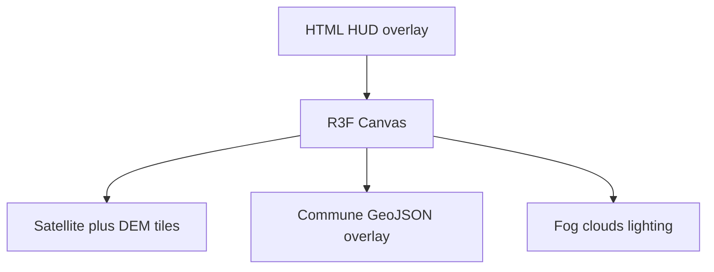

# Landing cinematic 3D Đồng Tháp (Next.js + Three.js)

Folder [`/home/hocnp/Desktop/travel`](/home/hocnp/Desktop/travel) đang trống. Ảnh 1 = HUD + sương mù + flyover; ảnh 2 = overlay hành chính. Ranh giới dùng **tỉnh Đồng Tháp sau sáp nhập 2025** (Đồng Tháp + Tiền Giang cũ, cấp xã/phường), không dùng bản huyện cũ trên ảnh.

Đồng bằng sông Cửu Long gần như phẳng: DEM thật sẽ không tạo “núi” như Blue Ridge. Scene 3D sẽ dựa trên **ảnh vệ tinh thật + sông/kênh + outline tỉnh**, phóng đại độ cao vừa phải, và lớp mây/sương để có cảm giác cinematic.



## Phase 0 — Initialize Next.js rồi commit

Chạy trong folder hiện tại (không tạo subfolder):

```bash
npx create-next-app@latest . --ts --tailwind --eslint --app --no-src-dir --import-alias "@/*" --use-npm --yes --disable-git
```

Sau đó cài stack 3D:

- `three`, `@types/three`
- `@react-three/fiber`, `@react-three/drei`
- `@react-three/postprocessing` (fog/bloom cho phase sau)

Thêm `dynamic(..., { ssr: false })` placeholder cho Canvas để Next không crash WebGL. Git init (nếu chưa có) và **một commit** theo đúng yêu cầu: initialize project.

Không dựng map trong commit này.

## Phase 1 — HUD cinematic (HTML/CSS)

Overlay fullscreen giống ảnh Primland, copy tiếng Việt:

- Header: menu, logo “Đồng Tháp”, CTA Inquire
- Center: kicker + tiêu đề lớn + subtitle + nút **Khám phá bản đồ**
- Footer: bắt đầu không audio
- Typography serif/display, chữ trắng, overlay tối nhẹ

File chính: [`app/page.tsx`](app/page.tsx), `app/globals.css`, `components/hero/HeroOverlay.tsx`.

## Phase 2 — Scene 3D nền

Canvas fullscreen phía sau HUD:

- Camera nhìn xuống ~45°, fog, hemisphere + directional light
- `OrbitControls` giới hạn góc (không lật dưới đất)
- Plane placeholder đúng bbox tỉnh để khóa tỷ lệ

Bbox mục tiêu (sẽ tinh chỉnh khi có GeoJSON mới): khoảng `10.0–10.9N`, `105.2–106.8E` vì tỉnh mới gồm cả Tiền Giang.

## Phase 3 — Địa hình “giống map thật”

Engine tile Web Mercator, không Mapbox token:

- Ảnh: Esri World Imagery (ghi attribution)
- Cao độ: AWS Terrarium DEM, decode RGB → vertex displacement, **exaggeration ~8–20x** vì đồng bằng quá phẳng
- Clip mesh theo polygon ranh tỉnh (stencil / discard fragment ngoài mask)
- Nhấn mạnh sông Tiền, sông Hậu, kênh (OSM waterways) bằng mesh/line hơi nổi

Thư mục dự kiến: `lib/geo/` (Mercator, tile URL, Terrarium), `components/map/Terrain.tsx`.

## Phase 4 — Overlay hành chính 2025

- GeoJSON cấp xã/phường (~102 đơn vị), nguồn OSM / vector công khai lúc implement
- Polygon màu bán trong suốt (palette gần ảnh 2), hover highlight, click focus camera
- Label: tỉnh láng giềng luôn hiện (Campuchia, An Giang, Long An, Vĩnh Long, Bến Tre…); tên xã chỉ hiện khi zoom gần hoặc hover — tránh 102 label chồng lên nhau
- Dữ liệu tĩnh trong `public/geo/` hoặc `data/`

## Phase 5 — Atmosphere + tương tác cinematic

- Lớp mây/sương (plane noise + fade) như ảnh 1
- Intro camera fly-in; nút Explore nới controls / hạ mây
- Audio ambient optional (mute mặc định, “bắt đầu không audio”)
- Postprocessing nhẹ: vignette, tone mapping — không nặng trên mobile

## Phase 6 — Polish

- Loading tiles, fallback nếu DEM lỗi
- Mobile: pinch/zoom, HUD co lại
- Performance: zoom tile vừa phải (z12–z14), dispose GPU
- Attribution Esri/OSM

Thứ tự làm sau khi plan được duyệt: **Phase 0 + commit trước**, rồi lần lượt 1→6. Mỗi phase có thể commit riêng khi bạn yêu cầu.
